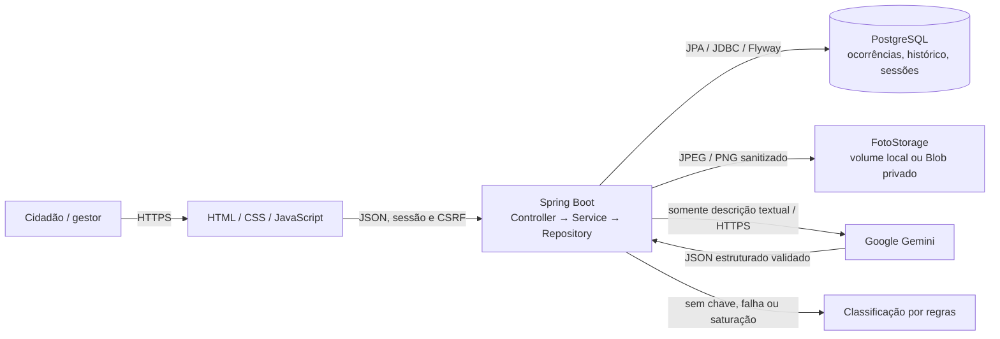

# HydroGuard Citizen 💧

**Global Solution FIAP 2026 — CitizenTech · ODS 6 e ODS 11**

O HydroGuard Citizen permite registrar vazamentos em espaços públicos, receber uma classificação preliminar e acompanhar o andamento por protocolo. A equipe gestora consulta os relatos em um painel protegido e registra as mudanças de status com histórico.

Vazamentos desperdiçam água e afetam vias, serviços e a qualidade de vida. A proposta aproxima cidadãos e gestores por um canal de informação organizado. O público-alvo são moradores, comunidades, equipes acadêmicas e gestores de infraestrutura hídrica. O impacto esperado é facilitar a identificação e a priorização de perdas; economia de água e tempo de reparo precisam ser medidos em uma implantação real.

O projeto é acadêmico. Os relatos não são encaminhados automaticamente a concessionárias ou órgãos públicos, e a aplicação não despacha equipes de reparo. Para emergências, utilize os canais oficiais.

## Funcionalidades e limites

- Cadastro com validação, protocolo UUID e persistência transacional.
- Consulta pelo protocolo completo, com status, prioridade, classificação e histórico. O resumo exclui endereço exato, descrição original, identificador interno e autores das alterações.
- Dashboard com contagens agregadas diretamente do banco: total, abertas, prioridade alta e resolvidas. Os números representam relatos, não perdas de água estimadas.
- Painel administrativo paginado com filtros combináveis de status, prioridade e busca por endereço/bairro/protocolo.
- Autenticação por usuário/senha BCrypt, sessões JDBC e perfis `ADMIN` e `ANALISTA`. Apenas `ADMIN` altera status; ambos consultam detalhes e fotos.
- Upload JPEG/PNG privado, pré-visualização no formulário e sanitização no backend. O autor pode anexar uma foto com autorização de uso único recebida no cadastro; administradores podem substituir fotos.
- Gemini real para texto quando houver uma chave válida, saída estruturada validada e fallback explícito por regras.
- Interface responsiva HTML/CSS/JavaScript, sem migração de framework. O histórico do cidadão existe apenas na memória da aba; guarde o protocolo antes de fechá-la.
- PostgreSQL como banco principal; H2 somente nos testes e no perfil de demonstração `local`.
- Migrações Flyway, suíte JUnit/Mockito/MockMvc, Docker/Compose, CI e preparação de CD com aprovação manual para Azure.

**Status verificado em 16/11/2026:** aplicação/API/interface e persistência exercitadas; **102 testes aprovados**, **CI GitHub concluído** e **build Docker completo com upload da imagem aprovado** no [run 43799275054](https://github.com/AndreKenji1/Global-Solution-HydroGuard/actions/runs/43799275054), commit `142e5fe`. Execução em Docker Compose também verificada. Permanecem para validação externa a chamada Gemini com chave real, Azure/Blob reais e a promoção pelo CD com aprovação manual; não há implantação de produção comprovada.

Consulte [o relatório de validação](docs/relatorio-validacao.md) e a [evidência do CI](docs/evidencias/github-ci.json) para comandos, resultados e limites. A execução bem-sucedida do CI prepara a imagem; a implantação depende de uma etapa de CD autorizada e verificada.

## Tecnologias e arquitetura

Java 17, Spring Boot 3.5.16, Spring MVC, Bean Validation, Spring Data JPA, Spring Security, Spring Session JDBC, Flyway, PostgreSQL 16, H2, Maven, JUnit 5, Mockito, MockMvc, JaCoCo, Docker, GitHub Actions e SDK Azure Blob/Identity.



A separação entre DTOs de entrada, resposta administrativa e acompanhamento limita a exposição de dados. A chamada Gemini termina antes da transação de criação para evitar reter uma conexão do banco durante uma dependência externa. Veja [arquitetura](docs/arquitetura.md), [segurança e LGPD](docs/seguranca-lgpd.md) e [operação Azure](docs/cloud.md).

## Instalação sem Docker

Requisitos: **JDK 17+**, **Maven 3.9+** e, para o modo principal, **PostgreSQL 16**. O JRE sozinho não contém o compilador necessário para o build.

1. Extraia o projeto e abra a pasta que contém `pom.xml`.
2. Crie no PostgreSQL um banco novo chamado `hydroguard` e um usuário próprio com permissão nesse banco. Não reutilize bancos existentes sem backup e plano de migração.
3. Configure as variáveis no terminal. Exemplo PowerShell, substituindo a senha solicitada:

   ```powershell
   $env:JDBC_URL='jdbc:postgresql://localhost:5432/hydroguard'
   $env:DB_USERNAME='hydroguard'
   $credencial = Get-Credential -UserName 'hydroguard' -Message 'Senha do PostgreSQL local'
   $env:DB_PASSWORD=$credencial.GetNetworkCredential().Password
   mvn clean verify
   mvn spring-boot:run
   ```

   Linux/macOS:

   ```bash
   export JDBC_URL='jdbc:postgresql://localhost:5432/hydroguard'
   export DB_USERNAME='hydroguard'
   read -rsp 'Senha do PostgreSQL: ' DB_PASSWORD; echo
   export DB_PASSWORD
   mvn clean verify
   mvn spring-boot:run
   ```

4. Abra **http://localhost:8080**. O login administrativo fica desabilitado enquanto não houver um hash de senha configurado. Cadastro e acompanhamento continuam disponíveis.

O arquivo `.env` é lido pelo **Docker Compose**. Maven/IntelliJ não o importam automaticamente: configure as variáveis no terminal ou na Run Configuration. No Windows, `iniciar-windows.bat` verifica Java/Maven e inicia o modo PostgreSQL usando o ambiente configurado.

### Demonstração offline com H2

Para uma demonstração sem PostgreSQL, selecione explicitamente o perfil local:

```bash
mvn spring-boot:run -Dspring-boot.run.profiles=local
```

O banco fica em `data/hydroguard-v2.mv.db`, as fotos em `uploads/`. Reiniciar preserva os dados. Esse perfil não substitui a validação com PostgreSQL. Não apague bancos, fotos ou volumes para contornar erros de migração.

### IntelliJ

Abra `pom.xml` como projeto Maven, selecione Project SDK **JDK 17+** e aguarde a importação. Execute `br.com.hydroguard.HydroGuardApplication` com `JDBC_URL`, `DB_USERNAME` e `DB_PASSWORD` na Run Configuration. Para demonstração H2, configure Active profiles=`local`. Execute os testes pelo Maven com `clean verify`.

## Configurar contas administrativas

Não existe senha ou token administrativo padrão. As contas são carregadas das variáveis de ambiente na inicialização, com senhas armazenadas como hashes BCrypt. Não há cadastro público de administradores nem recuperação de senha; alterar um hash exige reiniciar a aplicação e gerir as sessões existentes conforme a política operacional.

Gere um hash local sem colocar a senha em argumentos de comandos:

```bash
mvn --batch-mode dependency:build-classpath -Dmdep.outputFile=target/classpath.txt
java --class-path "$(cat target/classpath.txt)" tools/GerarSenha.java
```

PowerShell:

```powershell
mvn --batch-mode dependency:build-classpath '-Dmdep.outputFile=target/classpath.txt'
java --class-path (Get-Content target/classpath.txt -Raw).Trim() tools/GerarSenha.java
```

O utilitário precisa de um terminal interativo, solicita e confirma a senha sem exibi-la e imprime somente o hash. Use 12 ou mais caracteres e no máximo 72 bytes UTF-8. Defina `ADMIN_USERNAME` e `ADMIN_PASSWORD_HASH` com o valor completo. Para uma conta de consulta, use `ANALYST_USERNAME` e `ANALYST_PASSWORD_HASH`.

No PowerShell ou em `.env`, use **aspas simples** ao copiar o hash para preservar seus caracteres `$`. Exemplo de configuração, usando somente placeholders:

```dotenv
ADMIN_USERNAME=gestor
ADMIN_PASSWORD_HASH='<hash BCrypt gerado no terminal>'
ANALYST_USERNAME=consulta
ANALYST_PASSWORD_HASH='<outro hash BCrypt>'
```

A interface de Gestão envia credenciais ao backend, recebe uma sessão e exige CSRF nas alterações. As senhas não são guardadas no navegador. O cookie é `HttpOnly`, `SameSite=Strict`, com expiração por inatividade de 20 minutos. Em HTTPS, configure `COOKIE_SECURE=true`.

## Executar com Docker + PostgreSQL

Requisitos: Docker Engine/Desktop e Docker Compose v2.

```bash
# Linux/macOS; no Windows use: copy .env.example .env
cp .env.example .env
# Edite .env e preencha POSTGRES_PASSWORD com uma senha própria.
# Se desejar Gestão, configure ADMIN_USERNAME e ADMIN_PASSWORD_HASH.
docker compose up --build
```

Abra **http://localhost:8080**. O Compose exige `POSTGRES_PASSWORD`; não oferece uma senha alternativa fixa. Banco e aplicação vinculam suas portas a `127.0.0.1` por padrão. Fotos e PostgreSQL ficam em volumes persistentes. A imagem executa com usuário sem privilégios e o contêiner da aplicação tem filesystem somente leitura, exceto o volume de fotos e `/tmp`.

```bash
docker compose ps
docker compose logs app
docker compose down  # preserva os volumes
```

Para desenvolver Java no host usando apenas PostgreSQL do Compose, execute `docker compose up -d db`, configure `DB_PASSWORD` com a mesma senha do `.env` e use `mvn spring-boot:run`. `APP_PORT` e `POSTGRES_PORT` permitem ajustar as portas locais. Não use `down -v` em dados existentes sem autorização e backup.

### Imagem usando um JAR já validado

Em ambientes com pouco espaço para as camadas do JDK/Maven, compile e teste no host e selecione explicitamente o estágio `prebuilt` do mesmo Dockerfile:

```bash
mvn clean verify
docker compose build --build-arg JAR_SOURCE=prebuilt
docker compose up -d --no-build
```

Essa opção exige JDK/Maven no host e o JAR gerado em `target/`; a compilação e os testes ocorrem antes da construção da imagem. O modo padrão `docker compose up --build` continua realizando build/testes no estágio Maven do Dockerfile, sem depender de um Maven instalado no host. Use BuildKit, fornecido pelo Docker/Compose atuais.

## Variáveis de ambiente

| Variável | Uso / padrão |
|---|---|
| `JDBC_URL` | PostgreSQL principal: `jdbc:postgresql://localhost:5432/hydroguard` |
| `DB_USERNAME`, `DB_PASSWORD` | Usuário do banco e senha; senha sem default de demonstração |
| `POSTGRES_PASSWORD` | Obrigatória no Compose; repassada ao banco e à aplicação |
| `DB_POOL_SIZE` | Máximo de conexões por réplica; padrão `10` |
| `ADMIN_USERNAME`, `ADMIN_PASSWORD_HASH` | Conta `ADMIN`; hash vazio desabilita a conta |
| `ANALYST_USERNAME`, `ANALYST_PASSWORD_HASH` | Conta `ANALISTA`, somente leitura administrativa |
| `GEMINI_API_KEY` | Segredo opcional, exclusivo do backend |
| `GEMINI_MODEL` | Modelo; padrão `gemini-2.5-flash` |
| `GEMINI_TIMEOUT_SECONDS` | Timeout por chamada; padrão `8`, permitido até `30` |
| `STORAGE_PROVIDER` | `local` ou `azure`; padrão `local` |
| `UPLOAD_DIR` | Diretório local privado; padrão `./uploads` |
| `AZURE_STORAGE_BLOB_ENDPOINT` | Endpoint HTTPS da conta Blob |
| `AZURE_STORAGE_CONTAINER` | Contêiner privado, previamente provisionado |
| `AZURE_CLIENT_ID` | Opcional para identidade Azure atribuída pelo usuário |
| `AZURE_STORAGE_CONNECTION_STRING` | Alternativa de desenvolvimento; produção usa identidade gerenciada |
| `COOKIE_SECURE` | `true` em HTTPS; `false` somente no HTTP local |
| `PORT` | Porta HTTP; padrão `8080` |

## Endpoints REST

Todos os métodos que alteram dados, inclusive login, cadastro e upload públicos, exigem o token retornado por **GET `/api/auth/csrf`** no header `X-CSRF-TOKEN` e o cookie da mesma sessão. Após login/logout, busque novo CSRF. O frontend faz esse fluxo automaticamente.

| Método | Endpoint | Acesso / resposta |
|---|---|---|
| GET | `/api/info` | Público, informações da API |
| GET | `/actuator/health` | Público, saúde sem detalhes internos |
| GET | `/api/dashboard` | Público, `{total, abertas, prioridadeAlta, resolvidas}` |
| GET | `/api/auth/csrf` | Público, token CSRF da sessão |
| POST | `/api/auth/login` | Credenciais JSON + CSRF; sessão autenticada |
| GET | `/api/auth/me` | Sessão autenticada; nome e perfis |
| POST | `/api/auth/logout` | CSRF; invalida a sessão, HTTP 204 |
| POST | `/api/ocorrencias` | Público + CSRF; cria, HTTP 201 e `Location` do protocolo |
| GET | `/api/ocorrencias/protocolo/{protocolo}` | Público; resumo sem endereço/descrição original |
| GET | `/api/admin/ocorrencias` | `ADMIN` ou `ANALISTA`; página filtrada |
| GET | `/api/ocorrencias` | Alias administrativo da mesma listagem |
| GET | `/api/ocorrencias/{id}` | `ADMIN` ou `ANALISTA`; detalhes e histórico com autor |
| PATCH | `/api/ocorrencias/{id}/status` | Apenas `ADMIN` + CSRF |
| POST | `/api/ocorrencias/{id}/foto` | CSRF + `X-Upload-Token`, ou sessão `ADMIN` |
| GET | `/api/ocorrencias/{id}/foto` | `ADMIN` ou `ANALISTA`; imagem privada |

Cadastro:

```json
{"descricao":"Cano rompido com água jorrando na via pública","endereco":"Rua das Flores, 120","bairro":"Centro"}
```

`descricao`: 12–1000 caracteres; `endereco`: 5–180; `bairro`: opcional, até 90. Espaços nas extremidades são removidos antes da validação. JSON malformado, enums inválidos e campos desconhecidos são rejeitados.

A resposta de criação contém `id`, `protocolo` UUID e `tokenUpload`, além dos dados do relato. **`tokenUpload` só aparece nessa resposta**, expira em 30 minutos e é consumido após um upload bem-sucedido. O banco guarda apenas seu hash SHA-256. A consulta pública por protocolo não devolve esse segredo nem permite ler a foto.

Filtros administrativos: `?status=ABERTA&prioridade=ALTA&q=Centro&page=0&size=20`. A resposta é paginada, com `content`, `totalElements`, `totalPages` e `number`. `size` deve ser de 1 a 100, `page` começa em zero e `q` aceita até 180 caracteres. A ordenação é da ocorrência mais recente para a mais antiga.

Status: `ABERTA`, `EM_ANALISE`, `EM_ATENDIMENTO`, `RESOLVIDA`. Alterações para qualquer um desses status são permitidas ao administrador e registradas com data/autor; repetir o status atual não duplica o histórico. Prioridades: `BAIXA`, `MEDIA`, `ALTA`.

Fotos: campo multipart `foto`, JPEG/PNG decodificável, até **4 MiB**, até **4096 pixels por lado** e **12 milhões de pixels**. O backend reencodifica a imagem, removendo EXIF e outros metadados. WebP/SVG/GIF e conteúdo inválido são rejeitados; a restrição a formatos suportados pelo decodificador substitui a antiga validação apenas pela assinatura.

Erros têm JSON com `timestamp`, `status`, `message` e `path`; erros de validação também informam `fieldErrors`. Códigos principais: `400` entrada inválida, `401` autenticação ausente/inválida, `403` perfil/CSRF/token de upload inválido, `404` registro/foto ausente, `409` conflito de concorrência, `413` tamanho, `415` formato e `422` dimensões. Exemplos interativos estão em [docs/api.http](docs/api.http).

## Inteligência artificial textual

**A aplicação funciona sem chave Gemini.** Deixe `GEMINI_API_KEY` vazia para usar a classificação automática por regras locais, identificada como `REGRAS` na API e na interface. Nesse modo o backend não chama a API Google e não há consumo da Gemini. Somente para usar ou validar o Gemini real é necessário gerar uma chave e configurá-la como segredo, nunca no chat, no frontend ou no Git.

Defina `GEMINI_API_KEY` de forma segura antes de iniciar. O backend chama `https://generativelanguage.googleapis.com/v1beta/models/<modelo>:generateContent` com a chave no header; ela não vai para URLs, frontend ou Git. O envio contém somente a descrição, separada das instruções de sistema, e solicita JSON estruturado com:

```json
{"prioridade":"ALTA","categoria":"Vazamento intenso","justificativa":"Relato indica rompimento com fluxo intenso; requer revisão humana."}
```

O backend valida conclusão completa, campos exatos, tipos textuais, enum e limites: categoria até 70 caracteres e justificativa até 250. JSON inválido, timeout, falhas de autenticação, limite de requisições ou outras falhas resultam em regras locais; não bloqueiam o cadastro. Há limite de quatro chamadas simultâneas por instância para evitar saturação.

- `IA_GEMINI`: resposta da API validada.
- `REGRAS`: classificação automática por regras, sem chave configurada.
- `REGRAS_CONTINGENCIA`: classificação automática por regras após indisponibilidade, resposta inválida ou limite de concorrência.

A classificação é uma sugestão, não um laudo ou confirmação de urgência. **Não há análise de fotografias**. Não envie dados pessoais à descrição. A execução com uma chave real só pode ser comprovada quando uma credencial válida estiver configurada; mocks verificam o contrato sem consumir a API.

Para validar com uma chave guardada no GitHub, siga [o procedimento Gemini real](docs/gemini-validacao.md). O workflow manual inicia um backend isolado, envia um relato sintético e só aprova com `IA_GEMINI` persistida. O CI comum continua sem utilizar a chave real.

## Testes e colaboração Git

```bash
mvn clean verify
# Com PostgreSQL de testes configurado por JDBC_URL / DB_USERNAME / DB_PASSWORD:
mvn -Ppostgres-it clean verify
```

Os testes normais usam H2 em memória e Gemini mockada, sem chave real. A suíte cobre regras de prioridade, validação, JSON e status HTTP, protocolo, filtros/paginação, dashboard, autorização/CSRF, histórico, upload válido/inválido, limites de imagem, token de upload, persistência e adaptadores de storage. Os testes Gemini exercitam sucesso, respostas inválidas, timeout, interrupção, HTTP 401/403/429/5xx e concorrência. O perfil `postgres-it` executa testes Failsafe contra um banco PostgreSQL **isolado**, nunca o banco de produção. Relatórios ficam em `target/surefire-reports`, `target/failsafe-reports` e `target/site/jacoco`.

Os cenários [Gherkin](docs/cenarios-bdd.feature) descrevem o comportamento esperado; o arquivo `.feature` é documentação e não uma suíte Cucumber executável. Veja no relatório quais testes passaram e quais verificações manuais foram concluídas.

Use branches curtas, pull requests, revisão por colega e CI obrigatório na `main`. Mantenha o repositório privado durante o desenvolvimento acadêmico. `.env`, banco, fotos, cookies, logs e arquivos privados do HTTP Client não devem ser versionados.

## CI/CD e Cloud

O CI compila/testa com Java 17 e PostgreSQL efêmero, constrói uma imagem Docker e guarda o artefato por SHA. Esses passos foram executados com sucesso no [run 43799275054](https://github.com/AndreKenji1/Global-Solution-HydroGuard/actions/runs/43799275054), incluindo o build Maven completo dentro do Docker; a limitação de disco do ambiente local deixou de ser uma pendência de validação do build. O CD é iniciado manualmente, exige uma execução CI válida de `main` e aprovação do environment `production`, usa OIDC e promove a imagem por digest ao Azure Container Apps. Configure reviewers e o repository secret `ENVIRONMENT_READ_TOKEN` com `Administration:read` para verificar a proteção do environment; o token padrão do workflow não oferece essa permissão. Veja [docs/cloud.md](docs/cloud.md).

A arquitetura preparada utiliza Container Apps, Azure Database for PostgreSQL, Blob privado, Key Vault e Monitor/Log Analytics. O adaptador Blob e sessões JDBC permitem compartilhar estado entre réplicas; disponibilidade, backups, restauração, limites de escala e testes de carga dependem da configuração e validação no Azure. Esta entrega não deve ser descrita como publicada em produção sem deploy verificado.

Flyway inicializa **bancos novos** e o Hibernate valida o schema. Bancos legados do MVP (`ddl-auto=update`, sem protocolo/histórico) não são migrados automaticamente. Faça backup e teste um plano de migração/exportação em uma cópia antes de usar dados existentes; não use `baseline-on-migrate` ou limpeza automática para ignorar incompatibilidades.

## Contribuição aos ODS

- **ODS 6 — Água potável e saneamento:** participação na identificação de vazamentos e perdas, apoiando o uso eficiente da água.
- **ODS 11 — Cidades e comunidades sustentáveis:** canal acessível para participação cidadã e acompanhamento de problemas urbanos.

Os benefícios são objetivos do projeto, não métricas de impacto já demonstradas. Inclua integrantes, RMs e evidências da apresentação acadêmica conforme a entrega do grupo.

## Capturas da validação

As telas usam dados sintéticos. Resultados e limitações estão no [relatório de validação](docs/relatorio-validacao.md).


