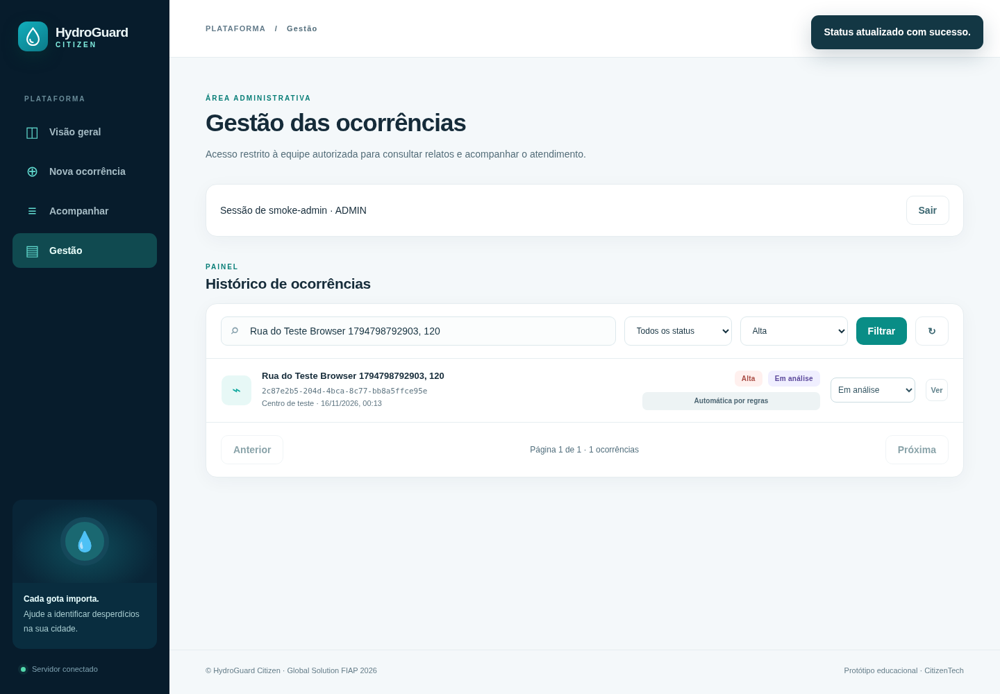
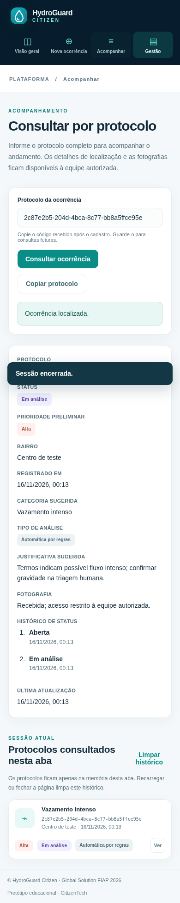
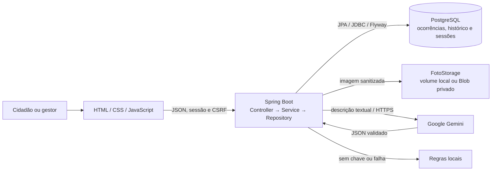

# HydroGuard Citizen 💧

**Global Solution FIAP 2026 — CitizenTech · ODS 6 e ODS 11**

Aplicação acadêmica para registrar vazamentos em espaços públicos, receber uma classificação preliminar e acompanhar o andamento por protocolo. A gestão consulta relatos e fotos em um painel protegido, filtra ocorrências e registra mudanças de status com histórico.

A proposta apoia a participação cidadã na identificação de perdas de água e problemas urbanos, em linha com os ODS 6 e 11. Economia de água e tempo de reparo são impactos esperados que precisam ser medidos em uma implantação real. A aplicação não encaminha relatos automaticamente a concessionárias nem despacha equipes; emergências devem ser comunicadas pelos canais oficiais.

## Prévia da interface

### Painel administrativo

Gestão das ocorrências com filtros, indicadores de prioridade e atualização de status.



### Consulta pelo celular

Acompanhamento por protocolo em uma interface adaptada para telas menores.



As capturas usam dados fictícios de demonstração.

## Tecnologias e arquitetura

Java 17, Maven 3.9+, Spring Boot 3.5.16, MVC, Bean Validation, JPA, Spring Security, Spring Session JDBC, Flyway e PostgreSQL 16. O frontend HTML/CSS/JavaScript, com identidade visual azul HydroGuard, é servido pelo backend. H2 fica restrito aos testes e ao perfil explícito de demonstração `local`.



Controllers recebem HTTP, services aplicam regras e transações, repositories consultam dados e DTOs separam cadastro, gestão e acompanhamento público. A classificação textual ocorre antes da transação de criação para não ocupar uma conexão do banco durante a chamada externa. Veja o [backend e frontend](src/main), os [testes](src/test) e as [dependências](pom.xml).

## Executar com Docker

Requisitos: Docker Engine/Desktop e Docker Compose v2. Na raiz do projeto:

```bash
cp .env.example .env
```

No Windows, use `copy .env.example .env`. Edite `.env` e preencha **`POSTGRES_PASSWORD` com uma senha própria**; o Compose exige esse valor. As contas de gestão são opcionais. Em seguida:

```bash
docker compose up --build
```

Abra **http://localhost:8080**. PostgreSQL e fotos usam volumes persistentes; as portas são vinculadas a `127.0.0.1`. `APP_PORT` e `POSTGRES_PORT` permitem mudar as portas locais. A imagem executa sem privilégios de root e o filesystem da aplicação é somente leitura, exceto fotos e `/tmp`.

```bash
docker compose ps
docker compose logs app
docker compose down
```

`down` preserva os volumes. Faça backup antes de remover volumes, bancos ou fotos. Para usar somente o banco no Docker e executar Java no host, inicie `docker compose up -d db` e configure `DB_PASSWORD` com a mesma senha do `.env`.

## Executar com Java e Maven

Instale **JDK 17+** e **Maven 3.9+**. Abra a pasta que contém [pom.xml](pom.xml). Para o modo principal, crie um banco PostgreSQL 16 novo chamado `hydroguard` e um usuário próprio com acesso a ele. Configure o ambiente do processo Java.

Linux/macOS:

```bash
export JDBC_URL='jdbc:postgresql://localhost:5432/hydroguard'
export DB_USERNAME='hydroguard'
read -rsp 'Senha do PostgreSQL: ' DB_PASSWORD
export DB_PASSWORD
mvn clean verify
mvn spring-boot:run
```

PowerShell:

```powershell
$env:JDBC_URL='jdbc:postgresql://localhost:5432/hydroguard'
$env:DB_USERNAME='hydroguard'
$credencial = Get-Credential -UserName 'hydroguard' -Message 'Senha do PostgreSQL local'
$env:DB_PASSWORD=$credencial.GetNetworkCredential().Password
mvn clean verify
mvn spring-boot:run
```

Abra **http://localhost:8080**. O arquivo [`.env.example`](.env.example) serve de referência: **Maven e IDEs não importam `.env` automaticamente**. Configure as variáveis no terminal ou na configuração de execução da IDE. No IntelliJ, importe `pom.xml`, selecione JDK 17+ e execute `br.com.hydroguard.HydroGuardApplication`. O [iniciador Windows](iniciar-windows.bat) usa o ambiente PostgreSQL já configurado.

Para demonstração sem PostgreSQL, selecione H2 explicitamente:

```bash
mvn spring-boot:run -Dspring-boot.run.profiles=local
```

O perfil `local` persiste o banco em `data/hydroguard-v2.mv.db` e as fotos em `uploads/`. Flyway inicializa schemas novos e Hibernate valida sua estrutura. Bancos legados precisam de backup e plano de migração testado; não habilite limpeza automática para contornar incompatibilidades.

## Contas de gestão

Não há senha administrativa padrão. Hash vazio desabilita a conta correspondente. `ADMIN` consulta detalhes e fotos e altera status; `ANALISTA` consulta os dados administrativos. As contas são carregadas do ambiente na inicialização, sem cadastro público ou recuperação de senha.

Gere BCrypt com o [utilitário local](tools/GerarSenha.java), em terminal interativo. Linux/macOS:

```bash
mvn --batch-mode dependency:build-classpath -Dmdep.outputFile=target/classpath.txt
java --class-path "$(cat target/classpath.txt)" tools/GerarSenha.java
```

PowerShell:

```powershell
mvn --batch-mode dependency:build-classpath '-Dmdep.outputFile=target/classpath.txt'
java --class-path (Get-Content target/classpath.txt -Raw).Trim() tools/GerarSenha.java
```

O programa solicita e confirma a senha sem exibi-la; não funciona em execução sem terminal interativo. Use ao menos 12 caracteres e no máximo 72 bytes UTF-8. Copie o hash completo para `ADMIN_PASSWORD_HASH` e defina `ADMIN_USERNAME`; para consulta, configure `ANALYST_USERNAME` e `ANALYST_PASSWORD_HASH`.

**Use aspas simples para preservar os caracteres `$` do hash**, tanto no shell quanto no `.env`. No PowerShell, atribua `$env:ADMIN_PASSWORD_HASH='<hash completo>'`; no Bash, `export ADMIN_PASSWORD_HASH='<hash completo>'`. No `.env`:

```dotenv
ADMIN_USERNAME=gestor
ADMIN_PASSWORD_HASH='<hash BCrypt completo>'
ANALYST_USERNAME=consulta
ANALYST_PASSWORD_HASH='<outro hash BCrypt completo>'
```

Reinicie a aplicação após alterar a configuração. Sessões ficam no banco e expiram após 20 minutos de inatividade; trocar o hash ou reiniciar não garante revogação imediata das sessões existentes. Os cookies são `HttpOnly` e `SameSite=Strict`; em HTTPS, configure `COOKIE_SECURE=true`.

## Configuração

| Variável | Finalidade / padrão |
|---|---|
| `JDBC_URL` | `jdbc:postgresql://localhost:5432/hydroguard` |
| `DB_USERNAME`, `DB_PASSWORD` | Credenciais PostgreSQL do processo Java |
| `POSTGRES_PASSWORD` | Obrigatória no Compose; usada pelo banco e pela aplicação |
| `DB_POOL_SIZE` | Conexões por instância; `10` |
| `ADMIN_USERNAME`, `ADMIN_PASSWORD_HASH` | Conta `ADMIN`; hash vazio desabilita |
| `ANALYST_USERNAME`, `ANALYST_PASSWORD_HASH` | Conta `ANALISTA`; hash vazio desabilita |
| `GEMINI_API_KEY` | Chave opcional e exclusiva do backend |
| `GEMINI_MODEL` | `gemini-flash-lite-latest` |
| `GEMINI_TIMEOUT_SECONDS` | `20`; valor positivo de até `30` segundos |
| `STORAGE_PROVIDER`, `UPLOAD_DIR` | `local` e `./uploads`; provider alternativo `azure` |
| `AZURE_STORAGE_BLOB_ENDPOINT`, `AZURE_STORAGE_CONTAINER` | Endpoint HTTPS e contêiner Blob privado previamente criado |
| `AZURE_CLIENT_ID` | Identidade Azure atribuída pelo usuário, quando aplicável |
| `AZURE_STORAGE_CONNECTION_STRING` | Alternativa de desenvolvimento à identidade gerenciada |
| `COOKIE_SECURE`, `PORT` | `false` no HTTP local e `8080`; use cookie seguro em HTTPS |

O [Compose](compose.yaml) usa armazenamento local. Para Blob, configure o ambiente da implantação e permissões da identidade sobre o contêiner privado. Mantenha chaves, senhas, hashes, cookies e tokens fora do Git, frontend e logs.

## Gemini e classificação

A chave pode ser obtida no [Google AI Studio](https://aistudio.google.com/app/apikey) e deve ser fornecida como `GEMINI_API_KEY` ao processo do backend. A integração envia **somente a descrição textual**, via HTTPS, e valida JSON estruturado com prioridade, categoria e justificativa. Fotos não são analisadas nem enviadas ao Gemini.

- `IA_GEMINI`: resposta válida recebida da API.
- `REGRAS`: classificação local quando não há chave configurada; nenhuma chamada Google ocorre.
- `REGRAS_CONTINGENCIA`: regras locais após timeout, erro, resposta inválida ou saturação.

O padrão é `gemini-flash-lite-latest`, com timeout de 20 segundos e até quatro chamadas simultâneas por instância. Disponibilidade, cotas e aliases `latest` dependem do fornecedor e da conta. Falhas externas preservam o cadastro com contingência explícita. A classificação é uma sugestão sujeita à revisão humana. Para conferir a integração em ambiente de teste, use uma descrição sintética, verifique `IA_GEMINI` na criação e consulte a classificação pelo protocolo. Configurar um segredo no GitHub não o transfere para Java local, Compose ou Azure.

## API REST

Operações de escrita exigem CSRF, inclusive cadastro e login. Primeiro consulte `GET /api/auth/csrf`, preserve o cookie da sessão e envie o token no header indicado por `headerName`. Após login, obtenha um novo token. A interface realiza esse fluxo automaticamente.

| Método | Endpoint | Acesso / resultado |
|---|---|---|
| GET | `/actuator/health`, `/api/info` | Saúde e identificação públicas |
| GET | `/api/dashboard` | Totais públicos: `total`, `abertas`, `prioridadeAlta`, `resolvidas` |
| GET | `/api/auth/csrf` | Token CSRF da sessão |
| POST | `/api/auth/login` | JSON `username`/`password`, CSRF; inicia sessão |
| GET | `/api/auth/me` | Identidade da sessão autenticada |
| POST | `/api/auth/logout` | CSRF; encerra sessão, HTTP 204 |
| POST | `/api/ocorrencias` | Público + CSRF; cria, HTTP 201 e `Location` do protocolo |
| GET | `/api/ocorrencias/protocolo/{protocolo}` | Resumo público pelo UUID completo |
| GET | `/api/admin/ocorrencias` | `ADMIN`/`ANALISTA`; listagem paginada |
| GET | `/api/ocorrencias` | Alias da listagem administrativa |
| GET | `/api/ocorrencias/{id}` | `ADMIN`/`ANALISTA`; detalhe e histórico com autor |
| PATCH | `/api/ocorrencias/{id}/status` | `ADMIN` + CSRF; JSON `{"status":"EM_ANALISE"}` |
| POST | `/api/ocorrencias/{id}/foto` | CSRF + `X-Upload-Token`, ou sessão `ADMIN` |
| GET | `/api/ocorrencias/{id}/foto` | `ADMIN`/`ANALISTA`; foto privada |

Cadastro de exemplo: `{"descricao":"Cano rompido com água jorrando na via pública","endereco":"Rua das Flores, 120","bairro":"Centro"}`. Limites: descrição de 12–1000 caracteres, endereço de 5–180 e bairro opcional até 90; espaços externos são removidos e campos desconhecidos rejeitados.

A criação devolve `id`, `protocolo` UUID e `tokenUpload`. O token aparece somente nessa resposta, expira em **30 minutos** e é consumido após um upload bem-sucedido; apenas seu hash fica no banco. Guarde o protocolo: o histórico do cidadão permanece somente na memória da aba. A consulta pública omite endereço exato, descrição original, ID interno, autores e token; mostra classificação, bairro, status e etapas. O dashboard contém apenas agregados.

Filtros combináveis: `?status=ABERTA&prioridade=ALTA&q=Centro&page=0&size=20`. A página inicial é zero, `size` aceita 1–100 e `q` até 180 caracteres; a ordem é da ocorrência mais recente. Status: `ABERTA`, `EM_ANALISE`, `EM_ATENDIMENTO`, `RESOLVIDA`; prioridades: `BAIXA`, `MEDIA`, `ALTA`. Mudanças registram autor/data; repetir o status atual não duplica o histórico.

Fotos usam multipart no campo `foto`: **JPEG/PNG, até 4 MiB, 4096 pixels por lado e 12 milhões de pixels**. O backend decodifica e reencodifica a imagem, removendo metadados. Formatos/conteúdo inválidos são rejeitados. Erros principais: `400` validação, `401` autenticação, `403` autorização/CSRF/token, `404` ausente, `409` concorrência, `413` tamanho, `415` formato e `422` dimensões.

## Testes

```bash
mvn clean verify
mvn -Ppostgres-it clean verify
```

A suíte padrão contém 102 testes Java com H2 em memória e Gemini simulada, sem consumir chave real. O perfil `postgres-it` totaliza 104 testes e exige `JDBC_URL`, `DB_USERNAME` e `DB_PASSWORD` de um PostgreSQL **isolado para testes**. Cobrem validação, persistência, classificação, autorização/CSRF, filtros, histórico, upload e contingências Gemini. Relatórios ficam em `target/surefire-reports`, `target/failsafe-reports` e `target/site/jacoco`.

O [smoke opcional da interface](tests/ui/smoke.cjs) requer Node.js 20+, Chromium do Playwright e uma aplicação de teste em execução. Configure `HYDRO_SMOKE_URL`, `HYDRO_SMOKE_USERNAME` e `HYDRO_SMOKE_PASSWORD` com uma conta `ADMIN` de teste; o script cria uma ocorrência sintética, envia foto e altera seu status. Instale as dependências e o navegador antes de executar:

```bash
npm --prefix tests/ui ci
npm --prefix tests/ui exec -- playwright install chromium
npm --prefix tests/ui test
```

## CI/CD e implantação

O [CI](.github/workflows/ci.yml) executa Java 17, testes com PostgreSQL efêmero e build Docker, disponibilizando a imagem por SHA. O [CD manual](.github/workflows/deploy-azure.yml) recebe `ci_run_id` de um CI aprovado de `main`, confere a origem e o resultado dessa execução, baixa a imagem correspondente e a promove por digest. O workflow exige revisores obrigatórios e bloqueio de autoaprovação no environment `production`. Configure também, nas opções do GitHub, bloqueio de bypass administrativo e política exclusiva para `main`; o secret `ENVIRONMENT_READ_TOKEN` precisa de `Administration:read`. O login Azure usa OIDC e as sete variáveis `AZURE_CLIENT_ID`, `AZURE_TENANT_ID`, `AZURE_SUBSCRIPTION_ID`, `AZURE_ACR_NAME`, `ACR_LOGIN_SERVER`, `AZURE_CONTAINER_APP` e `AZURE_RESOURCE_GROUP`. Os recursos Azure devem ser provisionados externamente: ACR, Container Apps em modo `Single`, PostgreSQL gerenciado, Blob privado e identidade/permissões, com segredos e observabilidade configurados. O projeto ainda não está publicado no Azure; disponibilidade, escalabilidade, backup e restauração precisam ser configurados e validados na implantação.

## Privacidade e limites operacionais

Use dados e imagens sintéticos na demonstração. Endereço, descrição, bairro, foto e classificação podem identificar pessoas. Evite rostos, placas, documentos e dados pessoais desnecessários: remover metadados não apaga informações visíveis. Proteja protocolo e token de upload e restrinja o acesso administrativo. Quando Gemini estiver habilitada, avalie e informe o envio da descrição ao fornecedor.

Uma operação com dados reais exige responsável, finalidade e base legal definidas, aviso de privacidade, canal de direitos, revisão de fornecedores, política de retenção e descarte, backup e resposta a incidentes. **Não há retenção/exclusão automática, portal de direitos, moderação automática ou endpoint completo de anonimização/eliminação.** A aplicação também não oferece MFA, diretório de usuários ou recuperação de senha. Esses controles e procedimentos devem ser preparados conforme a operação; o protótipo não representa certificação de conformidade com a LGPD.
