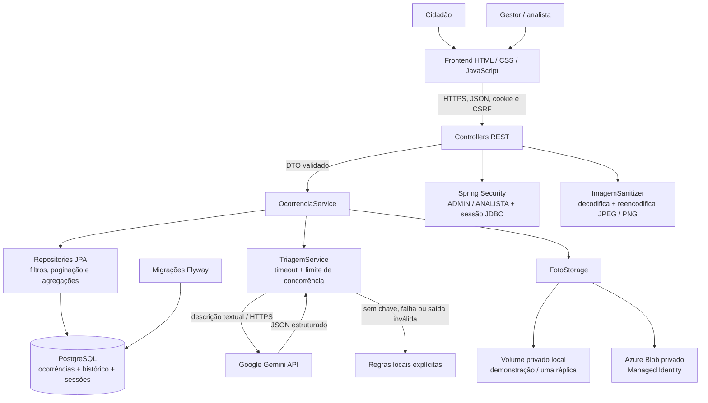

# Arquitetura — HydroGuard Citizen

## Componentes e interações

## Responsabilidades

| Camada | Responsabilidade |
|---|---|
| Controller | Rotas HTTP, Bean Validation, DTOs, paginação e respostas |
| Security | Sessão, CSRF, autenticação BCrypt, perfis, headers e erros de acesso |
| Service | Triagem, protocolo, regras de negócio, transações, histórico e vínculo de fotos |
| Repository | Persistência e consultas filtradas/agregadas no banco |
| Entity | Mapeamento JPA e controle de concorrência otimista |
| DTO | Separação entre entrada, criação/gestão e resumo de acompanhamento |
| Storage | Operações privadas de gravação/leitura/exclusão, local ou Blob |
| ImagemSanitizer | Validação do conteúdo decodificado, limites e remoção de metadados |

A opção pelo frontend estático mantém um único artefato Java e mesma origem para UI/API, evitando complexidade desnecessária para os fluxos atuais. O navegador não recebe chave Gemini nem acessa PostgreSQL/Blob diretamente.

## Fluxo de cadastro e classificação

1. O navegador obtém CSRF e mantém o cookie da sessão.
2. O controller valida descrição/local/bairro e chama o serviço.
3. A classificação textual usa Gemini com `responseSchema` quando há uma chave. A resposta precisa conter exatamente prioridade/categoria/justificativa textuais, dentro dos limites, com conclusão completa.
4. Sem chave, ou na contingência, o resultado é produzido por regras e recebe origem explícita. Um limite de quatro chamadas concorrentes por instância e timeout padrão de oito segundos protegem o backend da espera externa.
5. Só após a chamada externa o serviço abre a transação de escrita, gera protocolo UUID e token aleatório de upload, persiste ocorrência/histórico e devolve HTTP 201.
6. Caso haja foto, uma segunda requisição usa CSRF e token de upload. Se ela falhar, a ocorrência já criada continua válida e a interface informa a falha parcial.

Não existe transação distribuída entre banco e armazenamento. O serviço remove a foto anterior após commit e tenta remover a nova em rollback. Falhas de limpeza são registradas sem dados sensíveis e exigem reconciliação operacional de órfãos. Fotos não são enviadas à IA.

## Acesso, histórico e concorrência

A listagem paginada e os detalhes completos exigem `ADMIN` ou `ANALISTA`. A mudança de status exige `ADMIN`; data/autor entram no histórico e repetir o mesmo status não gera nova etapa. O estado pode ser atualizado para qualquer enum documentado; não há uma máquina de transições irreversíveis.

O protocolo UUID é a chave de acompanhamento do cidadão. A resposta pública omite endereço exato, descrição original, id interno e autoria administrativa, mas ainda contém bairro e a classificação resumida; trate o protocolo como informação a proteger. O dashboard público contém apenas contagens globais.

`@Version` e resposta HTTP 409 protegem alterações concorrentes. O token de upload é gerado com fonte criptográfica, armazenado somente como SHA-256, expira após 30 minutos e é consumido ao salvar a foto. Isso protege a fotografia de alterações arbitrárias por quem descobre um id sequencial.

## Persistência e perfis

PostgreSQL 16 é o banco principal. O profile `postgres` permanece como alias de compatibilidade. H2 em memória é usado pelos testes; `local` habilita H2 em arquivo `data/hydroguard-v2.mv.db` para demonstração explícita. Nenhum perfil de teste exige chave Gemini real.

Flyway mantém as tabelas de ocorrências, histórico e Spring Session JDBC. Hibernate usa `ddl-auto=validate`. Sessões compartilhadas no banco permitem continuidade entre reinícios/réplicas, respeitando sua expiração. Credenciais administrativas são carregadas do ambiente na inicialização, não de um cadastro público de usuários.

O schema inicial destina-se a bancos novos. O MVP antigo não possuía as novas colunas/restrições nem controle Flyway. Preserve backup, valide exportação/transformação em cópia isolada e planeje migração explícita antes de reutilizar dados legados. Não ative baseline ou limpeza automática apenas para forçar a inicialização.

## Cloud e operação

O adaptador Blob privado e as sessões JDBC preparam a distribuição do estado; o modo local de fotos pressupõe uma réplica. Container Apps, PostgreSQL gerenciado, Blob, Key Vault e Monitor são o destino planejado. Alta disponibilidade, restauração e escala precisam ser configuradas e verificadas na assinatura Azure. Consulte [cloud.md](cloud.md) para provisionamento, CI/CD com aprovação e limites operacionais.

A arquitetura não inclui integração com concessionárias, despacho de equipes, estimativa comprovada de água economizada nem classificação de fotografias. Os resultados efetivos de execução estão no [relatório](relatorio-validacao.md).
