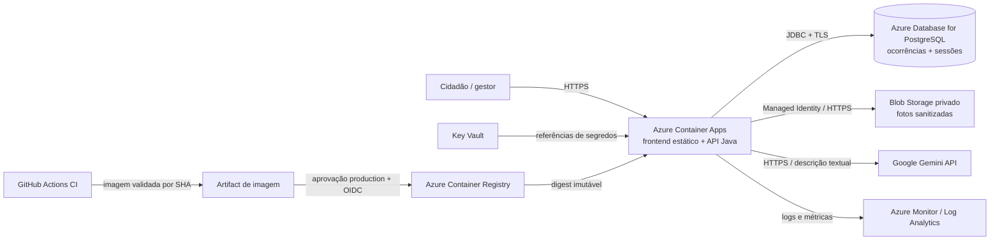

# Operação no Azure e entrega contínua

Atualizado em **16/11/2026**. O [CI run 43799275054](https://github.com/AndreKenji1/Global-Solution-HydroGuard/actions/runs/43799275054), commit `142e5fe`, concluiu com sucesso os 102 testes e o build/upload da imagem Docker. Esta documentação prepara a implantação Azure; a execução do CI não comprova promoção pelo CD nem publicação. Confira o [relatório](relatorio-validacao.md) e a [evidência do CI](evidencias/github-ci.json).

## Componentes e comunicação

O navegador acessa apenas o backend. O contêiner serve a interface HTML/CSS/JS e aplica autenticação, autorização, validação e acesso às fotos. O banco e os blobs devem permanecer privados. A chave Gemini existe somente no ambiente do backend; as fotografias não são enviadas à IA.

## Configuração dos recursos

1. Crie um Azure Container Apps Environment com Log Analytics, ingress HTTPS, target port `8080` e modo de revisão **Single**, exigido pelo workflow para encaminhar tráfego à revisão aprovada. Use ambiente com redundância de zona quando a região e a assinatura permitirem. A imagem executa com UID/GID `10001`, sem acesso de root.
2. Provisione Azure Database for PostgreSQL Flexible Server compatível com PostgreSQL 16, banco `hydroguard`, acesso privado e TLS obrigatório. Configure `JDBC_URL=jdbc:postgresql://<servidor>:5432/hydroguard?sslmode=verify-full`, `DB_USERNAME` e `DB_PASSWORD`. O truststore Java deve confiar na CA do serviço; mantenha a verificação de certificado.
3. Provisione Storage Account com acesso público desativado e um contêiner privado. Defina `STORAGE_PROVIDER=azure`, `AZURE_STORAGE_BLOB_ENDPOINT=https://<conta>.blob.core.windows.net` e `AZURE_STORAGE_CONTAINER=hydroguard-photos`. O adaptador usa `DefaultAzureCredential`. Atribua à identidade gerenciada do Container App o papel **Storage Blob Data Contributor**, limitado ao contêiner necessário. Para uma identidade atribuída pelo usuário, configure também `AZURE_CLIENT_ID`. Não forneça SAS pública às fotos.
4. Configure a identidade gerenciada do aplicativo com `AcrPull` no ACR. Configure referências do Key Vault para `DB_PASSWORD`, `ADMIN_PASSWORD_HASH` e `GEMINI_API_KEY`; conceda apenas a leitura dos segredos necessários. Use `ADMIN_USERNAME` e hash BCrypt próprio, sem senha ou token padrão.
5. Defina `SPRING_PROFILES_ACTIVE=postgres`, `COOKIE_SECURE=true` e `GEMINI_MODEL` quando necessário. O cookie de sessão deve trafegar por HTTPS; CSRF continua obrigatório para operações que modificam dados.
6. Configure probes de startup/liveness/readiness apontando aos endpoints de saúde disponibilizados pelo backend. A readiness deve refletir conectividade com o banco; evite reiniciar o aplicativo inteiro por uma indisponibilidade temporária da Gemini.

Antes de atender usuários reais, valide acesso privado, resolução DNS, regras de rede, TLS, permissões da identidade, envio/leitura de uma foto e um fluxo completo de login/cadastro/consulta. Não habilite Blob público para contornar problemas de autorização.

## Disponibilidade e escala

- **Banco:** habilite alta disponibilidade zonal quando suportada pelo plano/região. Ajuste o pool JDBC de todas as réplicas à capacidade de conexões do PostgreSQL. Migrações Flyway ocorrem na inicialização e devem ser verificadas em homologação antes da promoção.
- **Aplicação:** use revisões do Container Apps para implantação e rollback. Para evitar cold start em uma demonstração, mantenha ao menos uma réplica. Para disponibilidade entre zonas, planeje duas ou mais réplicas em um ambiente com redundância de zona e verifique capacidade do banco.
- **Fotos e sessões:** a execução local usa volume e deve operar com uma réplica. A configuração Azure usa Blob Storage e sessões JDBC compartilhadas, removendo essas dependências do disco de cada réplica. Ainda é necessário realizar teste de carga e failover antes de ampliar réplicas em produção.
- **Escalabilidade:** configure limites mínimo/máximo e regras por concorrência HTTP/CPU com base em medições. Limite requisições no gateway/WAF para proteger criação, login e consumo da Gemini. Não exponha diretamente os serviços de banco/armazenamento à Internet.
- **Dependência externa:** timeout e fallback por regras preservam o cadastro quando Gemini falha; a sugestão deve continuar identificada e sujeita à revisão humana.

## Backups, retenção e recuperação

- Configure backup automático do PostgreSQL com retenção definida pelo responsável (por exemplo, 14 dias dentro da capacidade do plano), recuperação point-in-time e, quando necessário, redundância geográfica.
- Habilite soft delete/versionamento de blobs e política de lifecycle alinhada à retenção aprovada para fotografias. Versionamento e backups também contêm dados pessoais; exclusão lógica não equivale a apagamento imediato de todas as cópias.
- Restrinja os backups a identidades de operação. Execute restauração periódica em um ambiente isolado e registre RPO/RTO medidos; não declare metas cumpridas sem exercício de recuperação.
- Defina processo de exclusão coordenada entre registros e fotografias, descarte ao fim da retenção e atendimento ao titular. Veja as decisões LGPD na documentação do projeto. Evite usar dados reais na apresentação acadêmica.

## Monitoramento

Colete logs estruturados no stdout, métricas de latência/erros HTTP, pool/conexões do banco, espaço/IOPS, disponibilidade dos probes e falhas/fallbacks Gemini. Configure alertas para erros 5xx, readiness indisponível, falhas de autenticação repetidas e saturação do banco. Os logs não devem conter senha, chave Gemini, cookie, token de upload, descrição completa ou fotografia. Mantenha o acesso ao Log Analytics limitado por RBAC e configure retenção.

## CI do repositório

`.github/workflows/ci.yml` executa em pushes e pull requests para `main`/`develop`:

1. Configura JDK 17 e cache Maven.
2. Inicia PostgreSQL efêmero e executa `mvn --batch-mode --no-transfer-progress -Ppostgres-it clean verify`, incluindo testes unitários/API H2 e testes de integração PostgreSQL pelo Failsafe.
3. Arquiva relatórios Surefire/Failsafe.
4. Constrói a imagem Docker da mesma revisão e salva `hydroguard-image-<sha>` como artifact por 14 dias. O Dockerfile também executa a suíte sem dependências externas. Nenhuma imagem é publicada automaticamente pelo CI.

A execução real validada gerou o artifact de imagem `14196076398` e o artifact de relatórios `14195432553`; os links e o SHA completo estão em [evidencias/github-ci.json](evidencias/github-ci.json). O build Docker padrão foi aprovado no runner GitHub, superando o bloqueio de armazenamento ocorrido no daemon local. Isso não comprova acesso ao ACR ou deploy Azure.

Proteja `main` com pull request, revisão por colega e o job `backend`/`image` obrigatório. Recomenda-se manter o repositório privado durante o desenvolvimento acadêmico. Não inclua `.env`, banco, fotografias ou relatórios com dados reais nos commits.

## CD com aprovação manual

`.github/workflows/deploy-azure.yml` recebe `ci_run_id` por **workflow_dispatch**. O workflow valida que a execução informada é o CI deste repositório, concluída com sucesso em um push de `main`. Baixa a imagem produzida naquele CI e a promove sem reconstrução. A imagem é enviada ao ACR por SHA e o Container App recebe sua referência por digest `sha256`, preservando a revisão efetivamente aprovada.

Antes de habilitar o CD:

1. Crie o GitHub Environment `production`, configure **required reviewers**, marque **prevent self-review**, restrinja deployments à `main` e desabilite bypass administrativo quando disponível. O job `validate` consulta a configuração e falha se não existir revisão obrigatória com prevenção de autoaprovação. Essa API exige `Administration:read` em repositório privado, permissão que o `GITHUB_TOKEN` padrão não oferece. Configure o **repository secret `ENVIRONMENT_READ_TOKEN`**, com um token de instalação GitHub App ou fine-grained PAT limitado a este repositório e somente essa permissão de leitura. O secret precisa estar no repositório, pois a consulta acontece antes da aprovação do environment. Sem token ou com consulta negada, o deploy permanece bloqueado; não remova a verificação para contornar o bloqueio.
2. Na Azure, crie uma aplicação/identidade federada com subject `repo:<org>/<repo>:environment:production`. Conceda `AcrPush` no ACR e permissão mínima para atualizar o Container App. O workflow usa OIDC (`id-token: write`), sem `AZURE_CREDENTIALS` de longa duração.
3. Defina variables no environment: `AZURE_CLIENT_ID`, `AZURE_TENANT_ID`, `AZURE_SUBSCRIPTION_ID`, `AZURE_ACR_NAME`, `ACR_LOGIN_SERVER`, `AZURE_CONTAINER_APP`, `AZURE_RESOURCE_GROUP`.
4. Provisione previamente banco, Blob, identidade de execução, referências Key Vault, ingress/probes e configuração do Container App. O workflow promove a imagem e não cria toda a infraestrutura.
5. Na branch `main`, informe uma execução CI cujo artifact ainda esteja retido. Após a revisão humana, o job publica a revisão, espera que ela seja a revisão mais recente pronta e verifica `/actuator/health` via HTTPS. Confirme também o fluxo funcional; um health check isolado não comprova todas as funcionalidades.

Se a promoção ou o smoke check falhar, o job falha. Investigue a revisão e faça rollback explícito para o digest anterior aprovado. O pipeline não apaga banco, volumes nem registros e não declara rollback automático. Não execute deploy nesta assinatura sem autorização do responsável pelos recursos.
